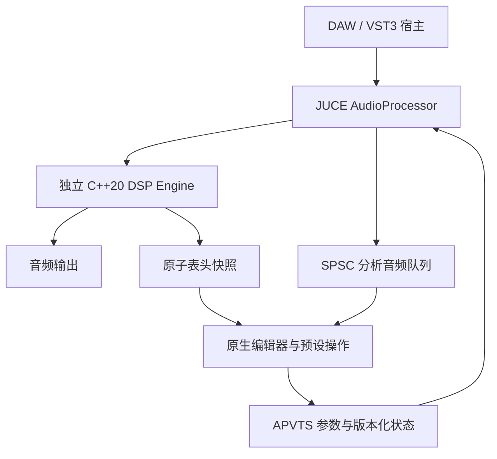

# AETHER Micro 第一阶段开发进度报告

> 报告日期：2026-10-23（Asia/Shanghai）  
> 阶段成果：AETHER Micro v1.0.0，Windows x64 首个可构建、可安装、可加载的版本化交付  
> 版本标签：`v1.0.0`  
> 对应源码提交：`0db4ca7c3fefc46731d5521838da7a19448e8ec7`  
> 开发分支：`codex/aether-micro-v1`  
> 文档性质：根据已交付版本的源码、构建记录、测试日志和发布包补写的阶段总结。

## 1. 阶段结论

第一阶段已完成从产品规划文档到 Windows x64 原生插件的工程闭环：建立独立 DSP 库、宿主处理层、参数和预设系统、原生编辑器、自动化测试、构建与打包脚本，并交付 FX 与 Synth 两款 VST3 及对应独立程序。

当前版本实现了五个实际工作的声音处理模块、三种工作模式、39 个宿主参数、24 种串联顺序、12 个工厂预设、DAW 状态恢复和 A/B 比较。两款实际构建的 VST3 均通过 pluginval 第 5 级验证；46 项 DSP 行为检查及 12 项处理器集成场景通过。

这里的“第一阶段”指本次实际完成的 **v1 工程落地阶段**。原产品规划书包含更长周期的研究路线，涉及训练式 DDSP、S4D 神经推理、WDF 电路建模、WGPU、跨实例网络和多平台交付。这些研究目标尚未全部实现。因此，本阶段可以认定为“首个完整版本已交付”，不能据此认定为“规划书全部研究内容已完成”。

### 1.1 完成状态概览

| 工作项 | 当前状态 | 可核查结果 |
|---|---|---|
| 产品规划读取与落地范围定义 | 已完成 | 读取 14 页规划书，形成设计说明与需求覆盖矩阵 |
| 独立 C++20 DSP 库 | 已完成 | MIT 许可、无 JUCE 依赖、五级声音处理 |
| FX／Resynth／Synth 模式 | 已完成 v1 实现 | 音频处理、单音音频重合成、8 复音 MIDI 合成 |
| VST3 宿主与总线 | 已完成 Windows x64 实现 | 独立 FX／Synth 标识；FX 单／立体声和外部侧链 |
| 参数、预设与状态 | 已完成 | 39 个参数、12 个工厂预设、JSON 文件、DAW 回读、A/B |
| 原生图形界面 | 已完成 | 可缩放编辑器、实际输出频谱、五模块卡片、极简模式 |
| 行为与集成测试 | 已完成当前范围 | 46 项 DSP 检查、12 项处理器场景、CTest 2/2 套件通过 |
| 实际 VST3 验证 | 已完成 | pluginval 1.0.4，strictness 5，两款插件均 SUCCESS |
| 本地性能与文件检查 | 已完成基础测量 | 实测模块体积、处理时间、WAV 数据和运行依赖检查 |
| 版本、封包与安装 | 已完成 | Git 标签、完整源码和依赖、SHA-256、用户目录安装 |
| 商业 DAW、外部声卡与主观听音 | 待验证 | 当前没有可宣称通过的实测记录 |
| 原规划高级研究功能 | 部分基础已建立，主体待研发 | 详见第 11 节 |

本报告不提供一个笼统的“总完成百分比”：已经交付的工程功能与尚未完成的研究任务，其工作量和验收条件差异较大，直接按条目计数会产生误导。

## 2. 输入材料与技术决策

### 2.1 项目起点

工作目录最初只有 Git 仓库和产品规划 PDF，没有可继续开发的插件工程、训练权重、采样库或现成 DSP 实现。

主要依据：

- [产品规划书](AETHER_Micro_VST3_Product_Design_Report.pdf)。
- [v1 设计说明](docs/superpowers/specs/2026-10-23-aether-micro-design.md)。
- [实施计划](docs/superpowers/plans/2026-10-23-aether-micro.md)。
- [规划功能与当前实现对照](docs/REQUIREMENTS.md)。

### 2.2 已采用的方案

| 领域 | 实际选型 | 选择理由与影响 |
|---|---|---|
| DSP | 标准 C++20 | 将核心算法与宿主、GUI 分离，便于独立测试和复用 |
| 宿主封装 | JUCE | 使用成熟的 VST3、音频总线、MIDI、参数与编辑器基础设施 |
| UI | JUCE 原生矢量绘制与 FFT | 直接交付可检查的原生界面，无 WebView 和图片资源依赖 |
| 构建 | CMake，MSVC x64，Ninja | 形成可重复运行的本地构建入口和 Windows CI 配置 |
| 参数 | AudioProcessorValueTreeState（APVTS） | 固定参数 ID，连接宿主自动化、GUI 和状态恢复 |
| 文件预设 | JSON `.aether` | 可阅读、可检查、可迁移，提供 schema 和产品标识 |
| 验证 | 独立 DSP 测试、处理器测试、pluginval | 同时检查算法、集成边界和实际插件加载行为 |

原规划中的 Rust／nih-plug／WGPU 三层方案在本阶段改为 C++／JUCE 实现；DSP 仍保持独立边界。此项改变已记录到设计及需求对照中。

### 2.3 依赖与许可

- JUCE 源码提交固定为 `501c07674e1ad693085a7e7c398f205c2677f5da`，该源码报告版本为 8.0.12。
- CMake 下载依赖时同时校验 SHA-256；发布包携带该固定依赖的源码压缩包。
- 本地 JUCE 目录原有一处添加 `<cstring>` 的修改，已保存对应补丁并在验证文档中披露。
- 独立 DSP 库采用 **MIT**。
- 完整 JUCE 插件及独立程序采用 **AGPL-3.0-or-later**，与 JUCE 8 使用的开源许可保持一致。
- 原规划提出的完整插件 GPL-only 分发方案在本阶段调整为 AGPL。具体见 [第三方说明](THIRD_PARTY_NOTICES.md) 和 [完整许可](LICENSE)。

## 3. 当前系统架构

### 3.1 分层结构



### 3.2 默认声音路径

```text
音频 / MIDI 输入
  → 选择声源模式并分析输入
  → Spectral：动态共振控制
  → Modal：模态共鸣
  → Colour：非线性染色
  → Space：反馈空间
  → 全局干湿混合与输出增益
  → Master：宽度、采样峰值保护与可选抖动
  → 输出
```

前四个处理级支持 `4! = 24` 种串联排列；Master 固定最后。合成／重合成声源在排序后的效果链之前生成，避免后级重新生成声源而覆盖前级处理结果。

FX 使用输入音频作为声音来源。Synth 使用 MIDI 生成声音。Resynth 从原始输入或侧链提取音高与响度，再生成新的声音。外部侧链接通时，还可作为模态级的独立激励源。

### 3.3 源码组织

```text
vst3development/
├─ CMakeLists.txt                 构建目标、版本及固定依赖
├─ Source/
│  ├─ Parameters.h/.cpp           39 个稳定参数及单位转换
│  ├─ PluginProcessor.h/.cpp      宿主、总线、MIDI、状态、分析队列
│  ├─ PresetManager.cpp           工厂／文件预设与 A/B
│  └─ PluginEditor.h/.cpp         原生编辑器、频谱与极简模式
├─ libs/aether-dsp/
│  ├─ include/aether/Engine.h     无 JUCE 依赖的公开接口
│  ├─ src/Engine.cpp              实际声音引擎
│  └─ LICENSE                    MIT 许可
├─ tests/
│  ├─ DspTests.cpp                46 项 DSP 行为检查
│  └─ PluginTests.cpp             12 项处理器集成场景
├─ tools/RenderAudio.cpp          试听渲染与本地基准测量
├─ scripts/
│  ├─ build.ps1                   构建并运行测试
│  ├─ package.ps1                 生成源码、发布包与校验清单
│  └─ install.ps1                 用户目录安装与旧版备份
├─ .github/workflows/build.yml    Windows 构建工作流配置
├─ docs/                         说明、需求、验证及设计记录
├─ third_party/                  本地依赖修改补丁
├─ out/                          本地界面截图和 WAV 输出
└─ dist/                         已封装的 v1.0.0 交付文件
```

## 4. 声音引擎开发进度

### 4.1 Spectral：动态共振控制

**已完成：**

- 24 个按感知频率分布的带通检测器。
- 实际音频能量包络分析及动态削减。
- Threshold 设置起作用的电平；Tame 设置削减深度。
- Focus 改变削减重点所在的频率范围。
- Preserve 根据快／慢包络差异减轻起音处的处理。
- 立体声检测与关联处理，降低左右声道处理不一致的风险。
- 即使旁通此处理级，分析数据仍可正常更新。

**实现边界：** 当前是滤波器组驱动的动态共振控制；尚未实现规划中的 2048 带 CQT、严格 Bark 掩蔽矩阵、瞬态／稳态／噪声正交分离、手绘 EQ 或向上频谱压缩。

### 4.2 Modal：模态共鸣

**已完成：**

- 每声道 12 个阻尼模态，左右频率存在轻微失谐。
- 通过阻尼旋转状态生成可衰减的共鸣。
- String、Plate、Beam、Membrane 四组频率比例。
- Decay、Brightness、Tune、Resonance 控制。
- 来自当前串联信号或外部侧链的激励。
- 状态限幅、小信号清理、重置和跨采样率准备。

模态之间采用轻微前馈耦合。Synth 的八个振荡器声部共用后级模态网络，当前没有为每个 MIDI 音符独立创建完整物理琴体。

**实现边界：** 尚未实现两个各 64 模态的完整物理系统、校准真实乐器、多接触点物理激励或六算子 PM 矩阵。

### 4.3 Colour：非线性染色

**已完成：**

- Silk、Ember、Iron 三种原创饱和曲线。
- Drive 增益、Bias 非对称偏置、Tone 音色控制。
- 一阶反导数抗混叠（ADAA），小差值时采用稳定回退计算。
- 高驱动输入限幅和直流分量处理。
- 直流阻断极点按采样率计算，对应约 10 Hz 的目标截止频率。

**实现边界：** 当前没有训练权重、NAM／AIDA-X 导入、S4D 神经推理、元件级 WDF 电路求解或二阶 ADAA。也没有测得可宣称的 86 dB 抗混叠信噪比。

### 4.4 Space：扩散空间与冻结

**已完成：**

- 八条预分配延迟线组成的 Householder 反馈延迟网络（FDN）。
- 按目标衰减时间设置反馈，配合阻尼和全通扩散。
- Space、Size、Time、Damping、Disperse 控制。
- Freeze 保留已有反馈能量，停止注入新的湿声激励。
- 冻结时固定延迟长度，反馈保持接近 1 且有状态边界保护。
- 活跃冻结状态向宿主报告无限尾音；普通状态报告有限尾音。

Freeze 在部分干湿混合下仍允许干声经过。它保存的是反馈空间的声音，不是原规划中的 FFT 频谱帧冻结。

**实现边界：** 尚未实现 16 路网络、Bézier／Hermite 时间变形、频谱随机相位冻结和极端时间拉伸。

### 4.5 Master：输出控制

**已完成：**

- Mid/Side 立体声宽度控制。
- 左右关联的即时采样峰值增益限制与可调恢复时间。
- Ceiling 输出上限。
- 可选 16-bit／24-bit 量级的 TPDF 抖动噪声。
- 抖动后继续执行采样峰值边界保护。

**实现边界：** 当前没有前瞻真峰值检测、重建峰值保证、LUFS 测量／匹配、九阶噪声整形或控制台编码／解码。抖动是在浮点音频中注入噪声，不负责把宿主流转换为整数位深。

## 5. FX、Synth 与 Resynth

| 项目 | FX | Synth | Resynth |
|---|---|---|---|
| 声源 | 输入音频 | MIDI 驱动振荡器 | 输入音频分析后生成新声源 |
| 音高来源 | 原始声音 | MIDI 音符、弯音和 Tune | 单音基频跟踪 |
| 响度来源 | 原始声音 | 力度和音符包络 | 输入响度包络 |
| 当前合成结构 | 对已有声音施加处理 | 正弦基音及少量二、三次泛音，最多 8 声部 | 跟随基频的正弦基音、少量滤波噪声，可叠加 MIDI |
| 合适素材 | 人声、乐器、鼓组等音频 | 旋律、和弦、MIDI 编曲 | 清晰的单音哼唱、贝斯、独奏 |
| 主要限制 | 参数结构切换仍可能产生瞬变 | 后级物理共鸣由声部共享 | 对复调、噪声、气声及复杂输入不够稳健 |

### 5.1 MIDI 完成项

- 最多八个同时活动声部，第九个音符按年龄替换最旧声部。
- Note On／Off、力度和短起音／释放包络。
- 按通道处理音符释放和延音踏板 CC64。
- 插件宿主层弯音映射为约 ±2 半音。
- All Notes Off／All Sound Off 和清空 DSP 状态的 Panic 操作。
- 按 MIDI 事件的采样位置切分处理，避免音符提前发声。

底层 Engine 的弯音接口可供测试直接指定半音值；测试中的一倍频变化不代表插件宿主弯音范围已经扩大为一个八度。

### 5.2 Resynth 完成项

- 对输入取绝对值并平滑，提取响度包络。
- 对低通后的输入作过零周期估计，跟踪约 35–2000 Hz 的单音基频。
- 对频率估计平滑，并在低电平时清理跟踪状态。
- 用估计音高和响度控制内部正弦／噪声声源。
- 在排序后的处理链之前生成新声源，使前级效果对生成音频实际起作用。

需要输入音频的 Resynth 工作流应使用 **AETHER Micro 效果器版本**。独立 Synth 插件按乐器总线配置，没有主音频输入。当前 Resynth 为确定性信号分析与合成，没有经过学习的音色编码器，也不能完整保留歌词或原始复杂频谱。

## 6. 参数、预设与状态系统

### 6.1 参数基础

- 当前共 39 个宿主可见参数。
- 使用固定的点分 ID 命名空间，如 `spectral.amount`、`space.freeze`。
- 使用 JUCE `ParameterID` 版本提示及 schema 1。
- GUI 通过 APVTS 附件连接参数；音频路径读取缓存的原子参数地址。
- 连续参数使用约 5 ms 平滑，较重的系数更新按 32 采样控制节奏执行。
- 宿主参数显示及文本输入同时处理百分比、Hz／kHz 等单位。

### 6.2 完整参数表

以下为效果器参数定义默认值。专用 Synth 插件构造时把模式设为 Synth；工厂预设可另行指定其他值。百分比按界面含义表示，内部通常存为比例。

| 组 | ID | 范围／选项 | 默认 |
|---|---|---|---|
| Global | `global.input` | -24 至 +24 dB | 0 dB |
| Global | `global.output` | -24 至 +12 dB | 0 dB |
| Global | `global.mix` | 0–100% | 100% |
| Global | `global.bypass` | 开／关 | 关 |
| Global | `global.mode` | FX／Resynth／Synth | FX |
| Global | `global.order` | 24 种排列 | Spectral → Modal → Colour → Space |
| Spectral | `spectral.enabled` | 开／关 | 开 |
| Spectral | `spectral.amount` | 0–100% | 35% |
| Spectral | `spectral.threshold` | -60 至 0 dB | -24 dB |
| Spectral | `spectral.focus` | 120–16000 Hz | 3500 Hz |
| Spectral | `spectral.transient` | 0–100% | 65% |
| Modal | `modal.enabled` | 开／关 | 开 |
| Modal | `modal.mix` | 0–100% | 0% |
| Modal | `modal.decay` | 0.08–12 s | 1.2 s |
| Modal | `modal.tune` | -24 至 +24 半音 | 0 |
| Modal | `modal.brightness` | 0–100% | 50% |
| Modal | `modal.material` | String／Plate／Beam／Membrane | String |
| Colour | `colour.enabled` | 开／关 | 开 |
| Colour | `colour.drive` | 0–30 dB | 0 dB |
| Colour | `colour.tone` | 0–100% | 50% |
| Colour | `colour.bias` | -0.5 至 +0.5 | 0 |
| Colour | `colour.model` | Silk／Ember／Iron | Silk |
| Space | `space.enabled` | 开／关 | 开 |
| Space | `space.mix` | 0–100% | 12% |
| Space | `space.size` | 0–100% | 50% |
| Space | `space.decay` | 0.1–20 s | 2.5 s |
| Space | `space.damping` | 0–100% | 50% |
| Space | `space.dispersion` | 0–100% | 20% |
| Space | `space.freeze` | 开／关 | 关 |
| Master | `master.enabled` | 开／关 | 开 |
| Master | `master.width` | 0–200% | 100% |
| Master | `master.ceiling` | -12 至 0 dB | -0.3 dB |
| Master | `master.release` | 10–500 ms | 100 ms |
| Master | `master.dither` | Off／16 bit／24 bit | Off |
| Modulation | `mod.rate` | 0.05–20 Hz；同步时为每拍循环数 | 0.5 |
| Modulation | `mod.depth` | 0–100% | 0% |
| Modulation | `mod.target` | None／Drive／Resonance／Space／Focus | None |
| Modulation | `mod.shape` | Sine／Triangle／Random hold | Sine |
| Modulation | `mod.sync` | 开／关 | 关 |

补充语义：

- `Resonance` 调制目的地实际改变模态音高；它不是给 Resonance 混合量简单加减。
- `space.dispersion` 的宿主参数可到 100%，DSP 内部目前将有效系数参数限制到 0.95，避免极端设置影响稳定性。
- 全局 Mix 为 0 时仍经过输出增益及已启用的 Master；完全原样比较应使用 Bypass。
- DSP 内部对某些参数允许更宽的防护范围，界面和宿主可设置范围以本表为准。

### 6.3 预设与状态

已完成 12 个工厂预设：

| 名称 | 设计用途 |
|---|---|
| Gentle Orbit | 默认轻度频谱控制与短空间 |
| Clean Canvas | 减少频谱及空间处理，作为调音起点 |
| Vocal Silhouette | 较强的重点频段共振控制 |
| Warm Console | 温暖饱和与少量空间 |
| Ember Guitar | 高驱动、非对称染色与短混响 |
| Iron Drum Room | 鼓组染色与紧凑房间 |
| Glass Resonator | 明亮的板状模态共鸣 |
| Wooden Echoes | 较暗的梁式共鸣 |
| Nebula Drift | 长尾空间与缓慢调制 |
| Resynth Halo | 音频重合成与长尾共鸣 |
| Prism Keys | 可直接用 MIDI 演奏的明亮音色 |
| Copper Strings | 较温暖的 MIDI 弦状音色 |

状态功能包括 JSON `.aether` 保存／加载、宿主 XML 状态回读、A/B 两组快照及选择状态回读、非法内容拒绝和数值范围约束。预设切换及 A/B 比较会请求清理 DSP 历史，避免旧尾音干扰新的比较。

## 7. 宿主、实时处理与界面

### 7.1 宿主与实时路径

| 项目 | 实现情况 |
|---|---|
| 插件标识 | FX 与 Synth 使用独立 VST3 插件代码 |
| 主总线 | FX 单声道／立体声；Synth 音频输出 |
| 侧链 | FX 可选单声道／立体声输入，用于分析及激励 |
| 任意块长 | 包装层以固定 512 采样缓冲分块，不根据回调大小扩容 |
| MIDI 时序 | 根据事件采样位置分段渲染 |
| 表头与分析 | 原子值发布表头，SPSC 队列传递分析音频 |
| 音频线程边界 | 处理路径不执行预设 JSON／XML、文件操作或 GUI 操作 |
| 内存 | 延迟线在 prepare 分配；稳态 Engine 更新、处理、MIDI 和 reset 检查未发现普通堆分配 |
| 无效输入 | 对非有限样本和异常参数进行清理／限制 |
| 宿主延迟 | 当前报告 0 个补偿采样；滤波与 ADAA 仍有自身相位／时间响应 |
| 尾音 | 普通状态有限尾音；活跃 Space Freeze 报告无限尾音 |

实时安全结论针对已检查代码和已执行测试，尚不构成对任意宿主环境、任意调度条件的形式化硬实时保证。

### 7.2 编辑器

- 默认 1080×760，可调整大小；最小 900×680。
- 已生成并检查 1080×760、1280×900、900×680 和极简视图截图。
- 五个模块卡片、开关、全部次级控制和 24 种排序入口可访问。
- 提供模式选择、预设加载／保存、A/B、旁通、Panic 和全局控制。
- 使用来自实际音频的 2048 点 Hann 窗 FFT 显示输出频谱。
- 常规可视更新约 30 Hz，每次只对最新完整帧进行一次 FFT。
- 极简模式复用同一组参数控制，暂停分析发布和 FFT 工作。
- 提供双击默认值、可编辑数值、键盘调节和提示信息。
- 异步文件对话框保留对象，并用 SafePointer 处理编辑器关闭后的回调。
- CPU 表头当前未接入有效测量时隐藏；没有用估算值冒充实时 CPU 仪表。

界面截图可在发布包的 `Preview` 目录查看；本地对应文件为 [主界面](out/screenshots/AetherMicro-main.png)、[最小尺寸](out/screenshots/AetherMicro-minimum.png)、[较大尺寸](out/screenshots/AetherMicro-large.png) 和 [极简界面](out/screenshots/AetherMicro-minimal.png)。

## 8. 测试、验证与测量结果

本节记录开发期间已经执行并保存的验证。编写本报告时核对了现存源码、日志和包文件，没有为文档改动重新开展一轮 DSP 或 DAW 测试。

### 8.1 测试环境

| 项目 | 已使用环境 |
|---|---|
| 操作系统 | Windows x64 |
| CPU | Intel Core i9-13900H，14 个物理核心／20 个逻辑处理器 |
| 主编译器 | MSVC 19.44.35229，x64 Release |
| 独立 DSP 交叉验证 | GCC 14.3.0，开启标准库边界断言的运行 |
| 构建 | CMake 4.3.2、Ninja |
| Windows SDK | 10.0.26100.0 |
| JUCE | 固定提交，源码版本号 8.0.12 |
| VST3 元数据 | SDKVersion 3.8.0 |
| 验证器 | pluginval 1.0.4，strictness 5 |

### 8.2 DSP：46 项行为检查

最终日志记录 46 个 PASS，`Failures: 0`。覆盖以下行为组：

| 行为组 | 已检查内容 |
|---|---|
| 透明与静音 | 全模块关闭的样本透明；默认 FX 静音不自发声；Synth 收到 MIDI 前静音 |
| 频谱与音高 | 持续 1 kHz 衰减、真实分析值、1 kHz 跟踪、关闭频谱处理时仍能分析 |
| 模态 | 冲激响应发声并衰减、外部侧链激励、满湿状态保留合成激励 |
| MIDI | A4 发声、释放、延音、Panic、第九音符替换、按通道释放、弯音 |
| 非线性 | 热输入及偏置下输出有界；44.1–192 kHz 归一化低频响应一致性 |
| 空间 | 立体声尾音、冻结保持有界、冻结排除新激励、重新 prepare 清理旧延迟长度 |
| 输出 | 采样峰值限制、左右幅度比保持、两种 TPDF 噪声量级 |
| 生命周期 | 确定性 reset、异常输入与参数清理、极端参数和多采样率稳定性 |
| 实时与分块 | 处理／更新／MIDI／reset 的普通堆分配计数；块长分割下的输出一致性 |
| 排序 | 24 种排列、全部六对级别前后顺序、前级对合成源和满湿模态实际生效 |
| Resynth | 单音音频驱动、输入静音后的包络消退、满湿保留 MIDI、旁通 Modal 仍能生成声源 |
| 调制 | 节奏同步 LFO 对声音产生实际调制 |

完整逐项记录位于发布包 [DSP 日志](dist/AetherMicro-1.0.0-Windows-x64/Validation/dsp-tests-final.log)。

### 8.3 处理器：12 项集成场景

| 序号 | 场景 | 最终结果 |
|---|---|---|
| 1 | 参数数量、稳定标识和数值范围契约 | PASS |
| 2 | 全局旁通在 1、17、64、513、4097 等块长下透明 | PASS |
| 3 | 宿主参数文本单位往返，含百分比／kHz／Hz／dB／ms | PASS |
| 4 | 活跃冻结向宿主报告无限尾音，关闭空间后恢复有限 | PASS |
| 5 | DAW 状态往返和损坏数据处理 | PASS |
| 6 | 全部工厂预设输出有限的立体声音频 | PASS |
| 7 | 用户 JSON 预设往返及 schema 检查 | PASS |
| 8 | A/B 独立参数及工程保存后的快照恢复 | PASS |
| 9 | 单声道总线、重复 prepare、44.1／48／96／192 kHz | PASS |
| 10 | MIDI 按事件时间戳开始发声，无提前发声 | PASS |
| 11 | 外部侧链激励模态且不直接泄漏到输出 | PASS |
| 12 | 编辑器多次创建／销毁及实际截图输出 | PASS |

最终结果为 `12 tests passed, 0 failed`。CTest 将 DSP 与处理器分别作为一个套件运行，结果是 **2/2 套件通过**；套件数不等于内部行为检查数。

证据：[处理器日志](dist/AetherMicro-1.0.0-Windows-x64/Validation/plugin-tests.log)、[CTest 日志](dist/AetherMicro-1.0.0-Windows-x64/Validation/ctest-final.log)。

### 8.4 实际插件：pluginval

| 插件 | 严格级别 | 最终日志时间 | 结果 |
|---|---|---|---|
| AETHER Micro | 5 | 2026-10-23 16:02:30 +08:00 | SUCCESS |
| AETHER Micro Synth | 5 | 2026-10-23 16:02:30 +08:00 | SUCCESS |

验证覆盖 44.1／48／96 kHz、64／128／256／512／1024 块长，以及实际加载、音频处理、状态、自动化、编辑器和总线相关检查。没有使用跳过 GUI 的选项。

pluginval 提供的外部 Steinberg validator 接入项因为没有指定独立 validator 路径而跳过。因此，这里不能写成“通过 Steinberg 官方独立 validator”。

最终日志存于发布包 `Validation/pluginval-fx` 和 `Validation/pluginval-synth`。

### 8.5 性能实测

基准在 48 kHz、立体声、默认参数下，为每个块提供新的约 0.2 幅度正弦输入；计时在 Engine::process 外部进行。

| 块长 | 音频时长 | 处理时间 | 单核实时预算比例 |
|---|---:|---:|---:|
| 64 | 10.000 s | 0.262564 s | 2.62564% |
| 256 | 10.000 s | 0.259793 s | 2.59793% |
| 1024 | 9.984 s | 0.230081 s | 2.30450% |

比例计算为 `处理时间 ÷ 音频时长 × 100%`。它是局部微基准，受电源、调度和负载影响，不是 DAW 显示的总体 CPU 使用率，也不代表最大复音／全参数极限情况下的上界。另一组把处理后输出反复送回引擎的行为测试循环约为 5%，两组输入工作负载不同。

原规划中的 1.4% CPU、9.2 MB RAM、6 ms 内启动和 86 dB 抗混叠 SNR 均没有在本阶段得到对应测量证明。

### 8.6 音频与二进制检查

三份试听均为 48 kHz、双声道、PCM16、8 秒：

| 文件 | 内容 | 采样峰值，满幅为 1 |
|---|---|---:|
| `01-Source.wav` | 程序生成的输入参考 | 约 0.3063 |
| `02-Prism-FX.wav` | 模态、染色和空间处理结果 | 约 0.4731 |
| `03-Prism-Keys.wav` | MIDI 合成输出 | 约 0.2325 |

WAV 数据检查确认格式、时长和非静音输出；没有据此宣称完成了主观听音或音色质量评审。

`dumpbin /dependents` 检查显示实际 FX 模块依赖 Windows 系统 DLL；发布不要求额外安装 JUCE、VCRUNTIME 或外部模型 DLL。该结论不覆盖尚未测试的旧版 Windows 或非 Windows 平台。

## 9. 已发现并关闭的关键问题

| 问题 | 影响 | 已执行修复 | 关闭依据 |
|---|---|---|---|
| Modal 使用排序前的输入作为激励 | 调整 Colour／Spectral／Space 与 Modal 的顺序可能不生效 | 生成声源提前；普通模态激励改取当前串联信号 | 新增前后顺序和全部六对级别比较，复核通过 |
| 满湿 Resynth 丢失生成源／MIDI | Resonance=100% 时无法保留重合成层 | 新声源统一在效果链前生成并进入模态 | 静音输入 MIDI 与跟踪音频叠加测试通过 |
| Colour 使用固定 DC 阻断极点 | 高采样率下低频被过度削弱 | 根据采样率计算约 10 Hz 极点 | 44.1／48／96／192 kHz 低频响应比较通过 |
| 冻结后降低采样率时保留旧延迟长度 | 可能越界读取 | reset 清理长度，再按新采样率准备 | 边界断言和 192 kHz → 8 kHz 重准备回归通过 |
| XML 回读把数字变成字符串后被拒绝 | 工程中的参数无法正确恢复 | 完整数字解析、有限性检查、规范节点合并 | 状态往返、损坏输入及 A/B 恢复通过 |
| 宿主只定义显示单位，没有反向解析 | “35%”或“3.5 kHz”输入后数值被错误夹紧 | 同时实现宿主数值到文本与文本到数值转换 | 先重现失败，再通过百分比、宽度和频率等往返测试 |
| 固定报告 30 秒尾音 | 宿主可能提前切断冻结声音 | 活跃冻结返回无限尾音 | 处理器测试及复核通过，VST3 重新验证 |
| 编辑器底部越过窗口边缘 | 底部面板被裁切 | 调整垂直分配，保留底部边距 | 最小／默认／较大尺寸截图检查 |
| 高频率分析可能积压队列 | 高采样率下显示滞后或重复计算 | 清空已到达样本，每次只分析最新完整帧 | 代码及界面复核 |
| 重复截图向旧 PNG 追加数据 | 查看时可能显示旧画面 | 写入前重定位并截断输出文件 | 每份截图只含一个 PNG 文件头 |
| 本地 Ninja 的中文包含前缀编码异常 | 头文件依赖没有正确跟踪，可能留下旧对象 | 规范化本地生成配置并重编译应用翻译单元 | 参数对象重新记录 645 项头文件依赖；最终构建测试通过 |

独立 DSP 审查先提出三项重要声音处理问题，修复后完成限定复核。整项目审查再提出宿主单位解析及冻结尾音两项问题，两项均在旧实现上复现失败，修复后 12 项处理器场景通过，限定复核结论为通过。

最终复核没有识别出其审查范围内尚未解决的重要发布阻塞项。该结论仍受到商业 DAW、长时间运行和音质测量未覆盖的限制。

## 10. 版本与交付清单

### 10.1 发布包

- 文件：[AetherMicro-1.0.0-Windows-x64.zip](dist/AetherMicro-1.0.0-Windows-x64.zip)。
- 大小：**40,867,598 字节**，约 40.87 MB（十进制）。
- SHA-256：

```text
4a4da51ccca9ce6ec84279d1d87a17387f2599360cc074f346d0a0dba712979e
```

包内内容：

| 目录／文件 | 内容 |
|---|---|
| `VST3/` | FX 与 Synth 两个完整目录式 VST3 |
| `Standalone/` | FX 与 Synth 独立程序 |
| `presets/` | 12 个 `.aether` 工厂预设文件 |
| `Source/` | 项目源码 ZIP 与固定 JUCE 源码 ZIP |
| `Validation/` | DSP、处理器、CTest、pluginval、基准和依赖日志 |
| `Preview/` | 四份实际编辑器截图 |
| `Audio/` | 三份试听 WAV |
| `docs/` | 使用说明、实现范围、验证记录和接口资料 |
| `licenses/` | JUCE 与 VST3 SDK 说明 |
| `install.ps1` | 安装和升级备份入口 |
| `SHA256SUMS.txt` | 包内 50 个文件的 SHA-256 清单 |
| `README.md`、`CHANGELOG.md` 等 | 构建、版本、使用及许可说明 |

### 10.2 模块体积与一致性

| 实际 VST3 二进制模块 | 大小 |
|---|---:|
| AETHER Micro.vst3 | 4,994,560 字节 |
| AETHER Micro Synth.vst3 | 4,993,536 字节 |

这些数字仅为 bundle 内的二进制模块体积，不包含清单、源码、独立程序或发布 ZIP。原规划的 3.8 MB 单模块目标尚未达到。

交付前已核对 ZIP 完整性、全部 50 项包内文件哈希、打包模块与构建模块一致、源码 ZIP 对应标签提交，以及安装模块与发布内容一致。

### 10.3 安装状态

两个插件已经安装到：

```text
C:\Users\24168\AppData\Local\Programs\Common\VST3\AETHER Micro.vst3
C:\Users\24168\AppData\Local\Programs\Common\VST3\AETHER Micro Synth.vst3
```

安装脚本曾在隔离测试目录执行两次，验证重复安装时会保留带时间戳的旧版本备份。正式使用时，在 DAW 中重新扫描该用户 VST3 目录；宿主未自动扫描此位置时需手动添加搜索路径。

### 10.4 主要提交

| 提交 | 阶段内容 |
|---|---|
| `3569a19` | 定义 v1 范围、设计及接口 |
| `c7dd4b5` | 流式 DSP 和基础行为检查 |
| `e585e9e` | 宿主参数、状态及预设集成 |
| `19759b3` | 修复串联生成源、满湿 Resynth 和跨采样率低频问题 |
| `e9c3071` | 原生编辑器与参数交互 |
| `d566bee` | 完成封包、使用文档和验证工具 |
| `588878f` | 修复冻结尾音及宿主单位解析 |
| `098ab42` | 完成阶段验证记录 |
| `0db4ca7` | 发布审计文档修正；最终 v1.0.0 标签基准 |

本进度报告在发布完成后补写，没有据此产生新的插件版本，也不属于此前封装的 v1.0.0 源码快照。

## 11. 与原产品规划的差距

| 原规划方向 | 当前已具备 | 尚待完成 |
|---|---|---|
| 微内核与组合处理 | 独立 DSP、五级处理、24 串联排列 | 任意 DAG、并联／M-S 分支及完整 SIMD 调度 |
| 心理声学频谱 | 24 带动态检测和瞬态保护 | 2048 带 CQT、Bark 掩蔽、正交分离和手绘 EQ |
| DDSP | 单音基频／响度提取和新声源生成 | 训练数据、编码器／解码器、64 谐波预测与学习管线 |
| 物理建模 | 12 模态／声道、四材质比例 | 双 64 模态、真实物理校准、每音符独立物理系统 |
| PM／波表 | 简单加法声部 | 六算子 PM 矩阵和波表频谱变形 |
| WDF／神经建模 | 原创饱和曲线与一阶 ADAA | WDF、S4D、RTNeural 集成、二阶 ADAA、模型导入／蒸馏 |
| 空间时间处理 | 八线 FDN、扩散和反馈冻结 | 16 线网络、频谱冻结、时间扭曲和极端拉伸 |
| 母带 | 宽度、采样峰值保护、TPDF | 真峰值、响度测量、噪声整形及控制台编解码 |
| 跨轨协同 | 宿主外部侧链 | 64 槽跨进程共享内存及自动掩蔽避让 |
| 调制 | 单 LFO、三形状、四个有效目标 | 多 MSEG、包络跟随路由、混沌及拖拽矩阵 |
| GUI | 30 Hz 原生矢量编辑器与极简模式 | WGPU、120 FPS、三维视图及 GPU 性能证明 |
| 格式和平台 | Windows x64 VST3 与独立程序 | CLAP、AU、MIDI 2.0、ARM64、macOS、Linux |
| 多声道 | 单／立体声 | Atmos、Ambisonics、64 声道 |
| 资源目标 | 已取得本地二进制体积及基准时间 | 3.8 MB、1.4% CPU、RAM、冷启动、SNR 等目标验收 |
| 开源与发布 | 本地源码、许可、标签及完整包 | 远程仓库发布、已执行的远程 CI、社区模型生态 |

原规划所述 M1–M3 底层研究任务，也不能简单视作已全部完成；本阶段交付的是可用工程基础和明确边界的 v1 声音实现。

## 12. 已知限制与待验证风险

1. **复杂音频的 Resynth。** 当前跟踪器面向单音。和弦、混音、噪声和不稳定基频可能引起错误跟踪。
2. **结构切换的瞬变。** 顺序、材质、模型、模块开关和空间尺寸属于离散或拓扑变化，尚未对所有切换实现交叉淡化。
3. **宿主兼容性覆盖。** pluginval 已通过，尚无 Ableton Live、Cubase、REAPER、Studio One 等具体商业宿主的人工回归记录。
4. **真实音质评估。** WAV 可渲染、非静音及数值稳定不等于主观音色质量通过；仍需听音、增益匹配 A/B 和参考素材比较。
5. **抗混叠与输出测量。** 没有频谱别名误差、重建真峰值、LUFS、THD+N 或噪声整形测量结论。
6. **长时间和极限负载。** 尚未建立长时间静音、极端自动化、最大并发实例、p99 耗时和掉音统计。
7. **浮点极小数。** JUCE 包装层具备非规格化数防护；独立库在所有嵌入宿主中的长期小信号 CPU 行为仍应单独测量。
8. **版本兼容。** 已固定 schema 和参数 ID，但没有历史多版本状态／预设迁移样本；后续发布必须保留兼容测试。
9. **平台与硬件。** 未验证非 Windows 平台、ARM64 和外部音频硬件，也未完成安装器签名等分发工程。
10. **许可约束。** 完整插件当前按 AGPL 开源条件组织；商业闭源分发需要另外确认依赖授权和产品许可方案。

## 13. 下一阶段建议与验收条件

下列内容是建议研发顺序，尚不代表已开始执行，也没有据此作出工期承诺。

### 13.1 优先级 P0：生产环境验证与稳定性

| 建议任务 | 建议验收条件 |
|---|---|
| 建立商业宿主矩阵 | 至少选择实际使用的主宿主及一个参考宿主，记录扫描、保存／重开、侧链、冻结、离线导出、窗口生命周期和自动化结果 |
| 建立音频回归素材 | 覆盖人声、贝斯、吉他、鼓组、正弦、冲激及静音，保存版本化输入和参考输出 |
| 增加长时间压力测试 | 连续运行、频繁 prepare、随机合法自动化和多实例测试中没有非有限输出、崩溃或无法解释的资源增长 |
| 优化结构切换 | 为关键参数／链路变更增加淡化或双状态切换，并用输出差分及听音验证爆音改善 |
| 建立性能分布 | 记录不同块长和采样率的平均、p95、p99 时间，区分 FX、Resynth、最大复音和冻结负载 |

### 13.2 优先级 P1：核心声音能力深化

| 建议任务 | 建议验收条件 |
|---|---|
| 改进单音跟踪 | 用已知基频、滑音及带噪素材测量音分误差、错误八度率和跟踪延迟 |
| 完善重合成音色 | 将基音、泛音幅度和噪声包络明确分离，比较频谱和包络误差 |
| 提升模态系统 | 先决定音符跟随／每声部琴体策略，再扩展模态数和可解释耦合，验证高音与长衰减稳定性 |
| 非线性测量 | 建立多频、大幅度和高采样率下的频谱／混叠基准，再决定二阶 ADAA 或过采样方案 |
| 输出级测量 | 引入可核查的重建峰值和响度测量后，再命名或承诺 True Peak／LUFS 功能 |

### 13.3 优先级 P2：高级规划与平台扩展

- 在数据、模型格式和质量基准确定后开展训练式 DDSP／神经建模。
- 按兼容性和测量结果决定是否接入 WDF、RTNeural、NAM 或其他模型系统。
- 分别立项跨实例网络、复杂调制矩阵、CLAP／MIDI 2.0 与多声道支持。
- 为 macOS、Linux 和 ARM64 建立实际构建、验证及平台许可检查。
- 对当前原生界面测量后，再决定 GPU／WGPU 重构的收益与成本。

### 13.4 建议的阶段出口

第二阶段宜先以“主宿主可重复使用、无关键稳定性缺陷、有可复现音频回归和性能数据”为出口。更高级的神经、频谱和平台功能可按独立可验收里程碑推进，避免同时替换宿主、UI 和全部 DSP 核心而失去问题定位能力。

## 14. 复现入口与资料索引

### 14.1 常规构建

在具备 Visual Studio 2022 C++ Desktop 工具、Windows SDK、Git、CMake 的环境中：

```powershell
./scripts/build.ps1 -BuildDirectory build -Jobs 4
```

使用固定的本地 JUCE 源码：

```powershell
./scripts/build.ps1 -BuildDirectory build -JucePath C:/SDKs/JUCE
```

本次实际环境使用过的 Ninja 入口：

```powershell
./scripts/build.ps1 `
  -BuildDirectory build-ninja `
  -Generator Ninja `
  -JucePath C:/SDKs/JUCE `
  -NinjaPath tmp/tools/ninja/ninja.exe `
  -VcVarsPath C:/SDKs/AetherBuildTools/VC/Auxiliary/Build/vcvars64.bat `
  -Jobs 4
```

上述 Ninja 路径为本次机器的开发环境路径；迁移机器时需要替换。CMake 的依赖下载需要网络；使用交付的 JUCE 源码时可通过 `JucePath` 指定本地依赖，并按验证说明应用已有补丁。

### 14.2 测试与试听

```powershell
ctest --test-dir build-ninja -C Release --output-on-failure
./build-ninja/AetherRender.exe out/audio
```

纯 DSP 可使用 `-DAETHER_BUILD_PLUGINS=OFF` 单独配置和测试。源码包含 Windows CI 工作流，但本阶段只确认配置存在，没有宣称远程 CI 已执行成功。

### 14.3 资料索引

| 资料 | 用途 |
|---|---|
| [README](README.md) | 产品、安装、构建和许可入口 |
| [中文使用说明](docs/USER_GUIDE.zh-CN.md) | 模式、旋钮、侧链和预设操作 |
| [实现范围](docs/REQUIREMENTS.md) | 原规划与当前版本的功能对照 |
| [验证说明](docs/VALIDATION.md) | 测试环境、实测结果和证据边界 |
| [版本记录](CHANGELOG.md) | 1.0.0 发布内容 |
| [DSP 接口](docs/engine-contract.md) | Engine／Parameters 边界 |
| [编辑器接口](docs/editor-contract.md) | GUI 与处理器通信契约 |
| [第三方说明](THIRD_PARTY_NOTICES.md) | 固定依赖、许可和来源 |
| [发布包](dist/AetherMicro-1.0.0-Windows-x64.zip) | 可安装的完整交付 |
| [发布包 SHA-256](dist/AetherMicro-1.0.0-Windows-x64.zip.sha256) | 下载／复制后的完整性检查 |

本报告以 v1.0.0 的实际源码、已保存运行记录和当前交付文件为依据。后续功能、音质提升和性能目标需要通过新的实现及验证记录更新，不能仅根据原规划中的描述推定已完成。
