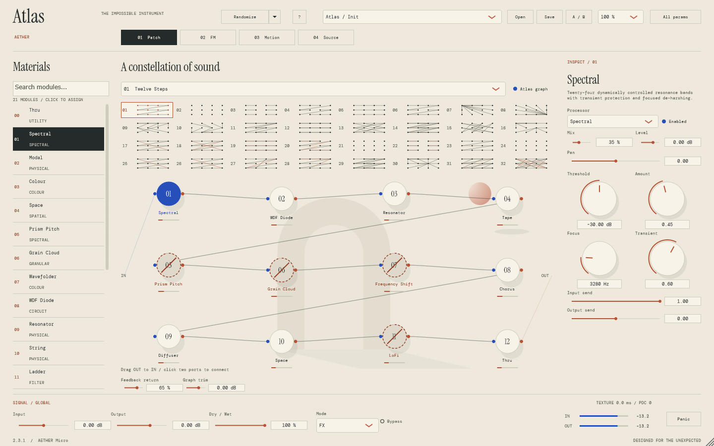
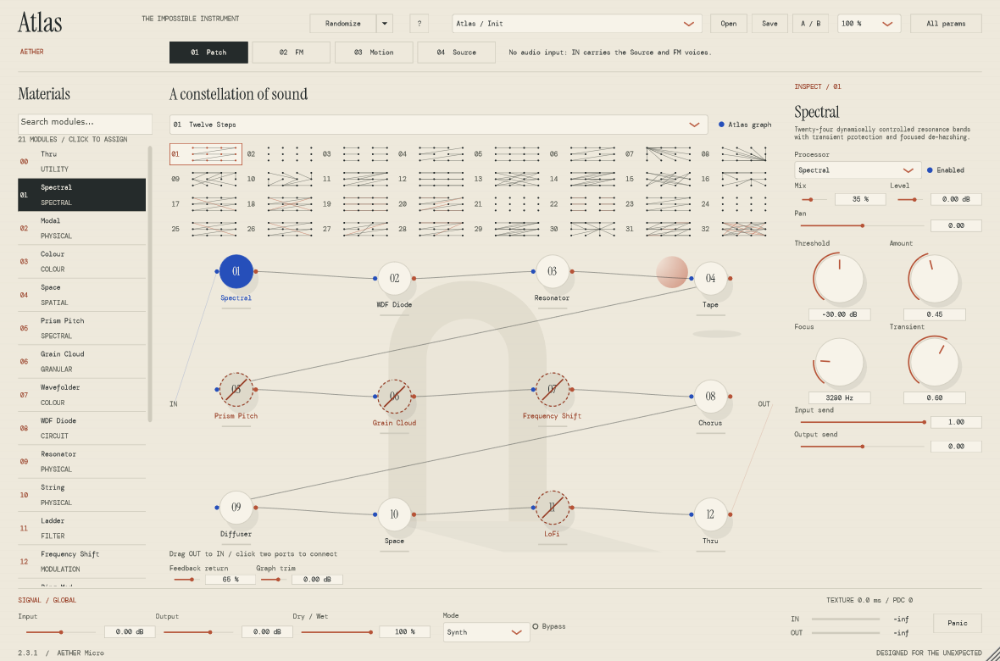
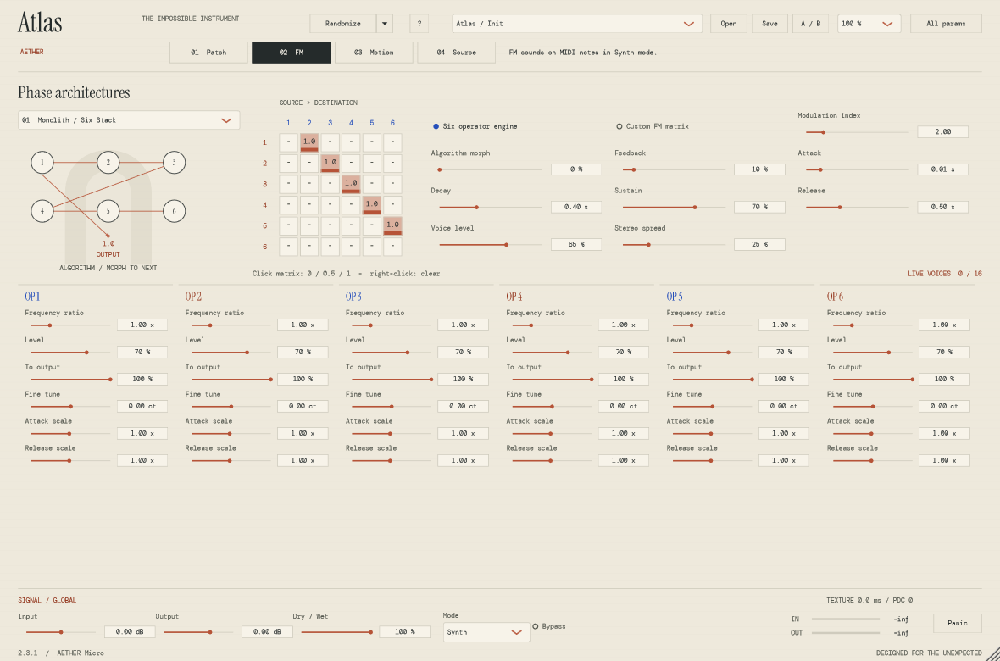
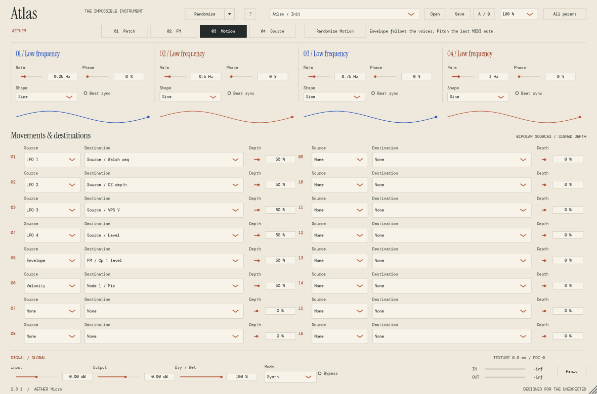
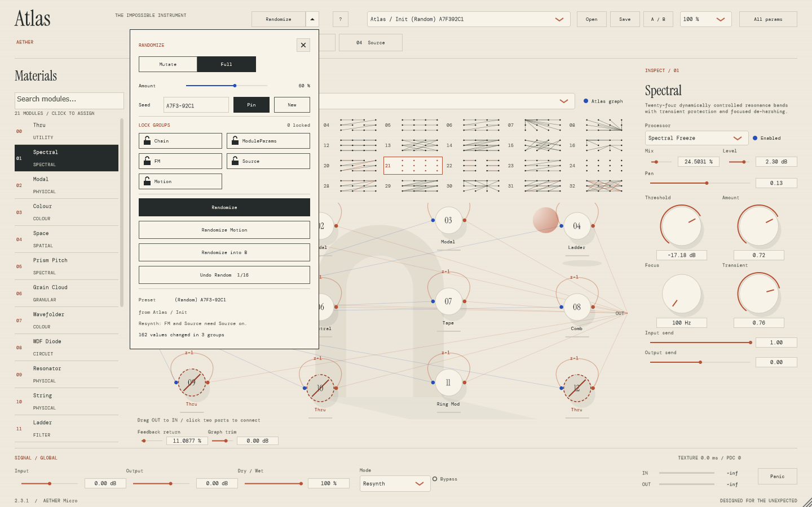

# AETHER Micro — Atlas 2.3.1

**A twelve-node patchable effect and six-operator FM instrument for Windows (VST3 + standalone).** Spectral material, physical bodies and phase architecture in one plugin.



**[Download AETHER 2.3.1 for Windows x64](../../releases/tag/v2.3.1)** · [All releases](../../releases) · [中文用户手册](docs/MANUAL.zh-CN.md)

## Highlights

- **Two plugins in one package.** *AETHER Micro* (audio effect, modes FX / Resynth) and *AETHER Micro Synth* (MIDI instrument, Synth mode). Both share the same 495 automatable parameters.
- **Patch.** Put any of **20 effects plus Thru** into **12 repeatable slots**. Choose one of **32 routing algorithms** or draw your own signed 12×12 matrix (serial, parallel, branching and one-sample feedback). Each slot has four module-specific macros, mix, level, pan and input/output sends.
- **FM.** **Six operators, 16 MIDI voices, 32 algorithms**, algorithm morph, an editable 6×6 matrix, ADSR and per-operator ratio / level / carrier / detune / envelope scales. In Resynth mode the voices follow the pitch and loudness of the incoming audio.
- **Source.** Two extra voice engines: **Phase Geometry** (Walsh, CZ-style phase distortion, VPS) and **Chaos** (GENDYN-style stochastic waveforms).
- **Motion.** Four LFOs plus envelope, velocity, pitch, random hold and chaos, routed through **16 rows to 112 destinations** (node macros/mix/level/pan and Source / FM parameters).
- **Global randomization.** One click rolls the whole patch (chain, module values, FM, Source and Motion) with lock groups, a reproducible seed, Mutate amount, *Randomize into B* and 16 undo steps. Bus volumes and output protection are never randomized.
- Real **Signalsmith Stretch**, **DaisySP** and **chowdsp_wdf** DSP; native JUCE UI with 50 / 75 / 100% zoom; **36 factory presets**, JSON `.aether` files, A/B and full DAW state recall. Older projects and presets still load.

| Synth edition | FM | Motion | Randomize |
|---|---|---|---|
|  |  |  |  |

Full manual in Chinese: **[docs/MANUAL.zh-CN.md](docs/MANUAL.zh-CN.md)**. Also see the [detailed guide](docs/USER_GUIDE.zh-CN.md), [modulation destinations](docs/modulation-destinations.md), [feature/provenance matrix](docs/REQUIREMENTS.md), [dependency research](docs/ATLAS_DEPENDENCIES.md), [actual validation](docs/VALIDATION.md) and the [changelog](CHANGELOG.md). The v1.0.0 docs are archived in `docs/archive/v1`.

## Install

1. Download `AetherAtlas-2.3.1-Windows-x64.zip` and its `.sha256` file from the [v2.3.1 release](../../releases/tag/v2.3.1). Check it with `Get-FileHash .\AetherAtlas-2.3.1-Windows-x64.zip -Algorithm SHA256`.
2. Extract the zip and run `install.ps1` from the extracted folder. By default it installs to `%LOCALAPPDATA%\Programs\Common\VST3`; for the system folder run an elevated PowerShell with `.\install.ps1 -Destination 'C:\Program Files\Common Files\VST3'`. Existing copies are renamed to `*.backup-<timestamp>`, not deleted. You can also copy both `.vst3` directories from `VST3/` by hand.
3. Close the DAW before upgrading, keep only one installed copy of each plugin, then rescan.

**AETHER Micro** goes on an audio/FX track; choose FX or Resynth. **AETHER Micro Synth** goes on a MIDI/instrument track and has no main audio input. Standalones are under `Standalone/`; configure their device selector. The FX standalone starts with its input muted to avoid feedback.

## Build

CMake 3.22+, Git, Visual Studio 2022 C++ tools and Windows SDK:

```powershell
./scripts/build.ps1 -BuildDirectory build -Jobs 4
./scripts/build.ps1 -JucePath C:/SDKs/JUCE
```

Without `JucePath`, CMake downloads a SHA-256-checked JUCE archive at commit `501c07674e1ad693085a7e7c398f205c2677f5da` (reports 8.0.12). DSP libraries/fonts are vendored. Apply `third_party/juce-local-cstring.patch` to match the original local JUCE include change; Atlas vendor changes are documented in `third_party/ATLAS_GRAPH_PATCHES.md`.

```powershell
# Developer environment with Ninja; optional -NinjaPath and -VcVarsPath supported
./scripts/build.ps1 -BuildDirectory build-ninja -Generator Ninja -JucePath C:/SDKs/JUCE
ctest --test-dir build-ninja -C Release --output-on-failure
./build-ninja/AetherAtlasRender.exe out/atlas-audio
```

Pure DSP builds use `-DAETHER_BUILD_PLUGINS=OFF`. Four CTest suites cover legacy, FM, modular graph and host/UI. Artifacts live under `AetherMicro_artefacts/Release` and `AetherMicroSynth_artefacts/Release`. A Windows CI workflow is supplied; local verification does not imply a remote CI run.

## Sound and performance boundaries

Pitch/formant and spectral freeze have STFT delay (measured 2560 samples at 48 kHz with default preparation). Frequency Shift has a 63-sample Hilbert delay. These are creative texture delays: **host PDC is zero and parallel paths are not automatically aligned**. TEXTURE displays the largest enabled single-node delay, not cumulative graph latency. Repeated spectral nodes can accumulate more delay. Use wet mix intentionally.

Six-operator FM uses fixed 4× processing and guarded ultrasonic operators. Extreme PM and nonlinear effects can still alias; no mathematically bandlimited or measured SNR guarantee. Sixteen FM voices alone can consume about half a realtime core on the development CPU; twelve expensive effects add work. Use sensible presets and your DAW's actual load. The UI hides unavailable CPU data.

Gain/index/feedback have short FM ramps; topology, material, morph and some operator edits remain immediate and can click. Freeze/recursive patches may persist indefinitely; Panic clears them. Master is sample-peak safety, not reconstructed true-peak/LUFS compliance. No trained DDSP/S4D/NAM models are included.

## License

Original legacy DSP, FM and modular wrapper/routing code: MIT (`libs/*/LICENSE`). Upstream algorithms retain MIT/BSD notices. Complete JUCE-linked application: **AGPL-3.0-or-later**. Fonts: SIL OFL 1.1. See `LICENSE` and `THIRD_PARTY_NOTICES.md`. Corresponding project/vendor source and pinned JUCE source are supplied. No commercial JUCE license or upstream endorsement is conveyed.
