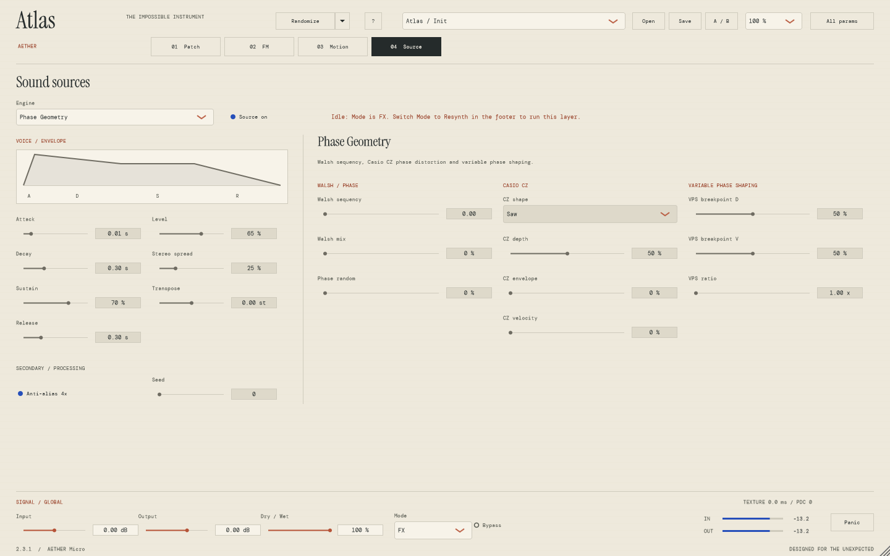
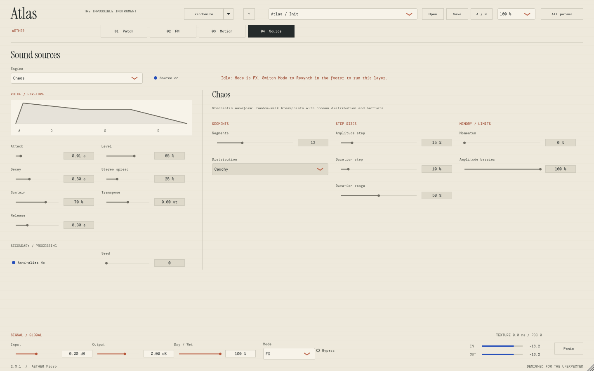
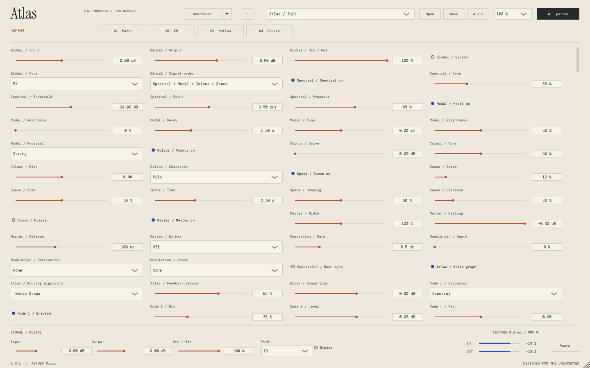
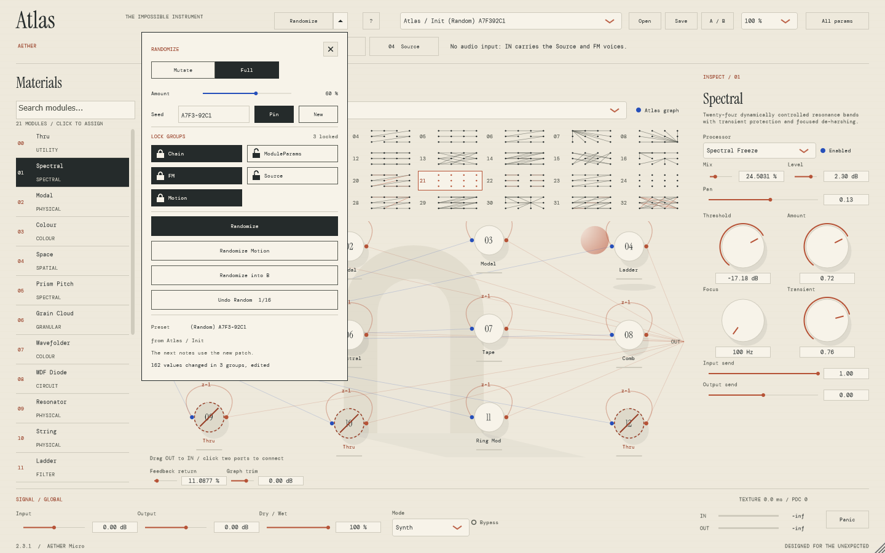

# AETHER Atlas 2.3.1 用户手册（中文）

> 本手册对应 Windows x64 发布包 `AetherAtlas-2.3.1-Windows-x64.zip`。文中的参数名称、范围和默认值都取自源码（`Source/Parameters.cpp`、`Source/AtlasParameters.cpp`、`libs/aether-modular/src/Metadata.cpp`、`libs/aether-rand`）。源码里没有写明的数值，本手册不给出。更细的技术说明见 [`USER_GUIDE.zh-CN.md`](USER_GUIDE.zh-CN.md)、[`modulation-destinations.md`](modulation-destinations.md) 和 [`randomization-spec.md`](randomization-spec.md)。


## 目录

1. [简介](#1-简介)
2. [两种形态：AETHER Micro 与 AETHER Micro Synth](#2-两种形态aether-micro-与-aether-micro-synth)
3. [安装](#3-安装)
4. [界面总览](#4-界面总览)
5. [01 Patch：效果图](#5-01-patch效果图)
6. [02 FM：六算子 FM](#6-02-fm六算子-fm)
7. [03 Motion：调制系统](#7-03-motion调制系统)
8. [04 Source：Phase Geometry 与 Chaos 声源](#8-04-sourcephase-geometry-与-chaos-声源)
9. [全局区与 All params](#9-全局区与-all-params)
10. [随机化（Randomize）](#10-随机化randomize)
11. [预设与 A/B](#11-预设与-ab)
12. [自动化与 DAW 使用建议](#12-自动化与-daw-使用建议)
13. [兼容性：旧工程与旧存档](#13-兼容性旧工程与旧存档)
14. [已知限制](#14-已知限制)
15. [从源码构建](#15-从源码构建)
16. [许可](#16-许可)

---

## 1. 简介

AETHER Atlas 是一个 VST3 插件（同时附带独立程序），由四部分组成：

- **Atlas 效果图**：12 个可重复的模块槽，21 种模块（含透明的 Thru），32 种内置路由算法加一个可自由接线的 Custom constellation，允许反馈回路。
- **六算子 FM**：16 声部，32 种算法，可在算法之间 Morph，也可以用 6×6 矩阵自定义。
- **Source 声源层**：Phase Geometry（Walsh / CZ 相位失真 / VPS）和 Chaos（GENDYN 式随机波形）两种引擎。
- **Motion 调制**：4 个 LFO、16 条调制分配，可指向 112 个目的地（节点宏和 Source / FM 参数）。

插件共有 495 个宿主参数，全部可自动化。另带 36 个工厂预设、A/B 比较、`.aether` 预设文件，以及覆盖整个工程的随机化（2.3.1 起默认为 Global 档）。

## 2. 两种形态：AETHER Micro 与 AETHER Micro Synth

发布包里有两个插件，参数表完全一样，区别在于插件类型和可用的 Mode：

| 插件 | 插入位置 | 可用 Mode | 用途 |
|---|---|---|---|
| **AETHER Micro**（效果器） | 音频轨 / 效果槽 | FX、Resynth | 处理输入音频；Resynth 模式下由输入音频的音高和包络驱动 Source / FM 声部 |
| **AETHER Micro Synth**（乐器） | MIDI / 乐器轨 | 只有 Synth | 用 MIDI 演奏 16 声部 FM 和 Source 声源，没有主音频输入 |


- `global.mode` 的三个选项（0 = FX，1 = Resynth，2 = Synth）和参数 ID 在两个插件里相同。Mode 菜单只列出当前插件能用的项，限制只在处理器读取模式时生效，不改写已保存的值。
- 在 Synth 版里，信号图的 IN 端承载的是 Source 和 FM 声部，界面会提示 “No audio input: IN carries the Source and FM voices”。
- AETHER Micro 在 FX 模式下，Source 层不发声（Source 页显示 Idle 提示），切到 Resynth 才会运行。
- 独立程序在 `Standalone` 文件夹里，在设置中选择声卡和 MIDI。FX 独立程序启动时输入是静音的，确认不会啸叫后再打开。

## 3. 安装

### 3.1 下载与校验

从本仓库的 GitHub Releases 页面下载 `AetherAtlas-2.3.1-Windows-x64.zip`，以及同名的 `.sha256` 文件。在 PowerShell 里校验：

```powershell
Get-FileHash .\AetherAtlas-2.3.1-Windows-x64.zip -Algorithm SHA256
```

输出的哈希应与 `.sha256` 文件里的值一致（不区分大小写）。解压后，包内还有 `SHA256SUMS.txt`，记录了每个文件的哈希。

### 3.2 压缩包内容

| 路径 | 内容 |
|---|---|
| `VST3/` | `AETHER Micro.vst3`、`AETHER Micro Synth.vst3` |
| `Standalone/` | `AETHER Micro.exe`、`AETHER Micro Synth.exe` |
| `install.ps1` | 安装脚本（见下） |
| `presets/` | 工厂预设的 `.aether` 文件 |
| `docs/` | 说明文档 |
| `Preview/` | 界面截图 |
| `Audio/`、`Validation/` | 试听音频和验证记录 |
| `Source/` | 本程序源码包 `AetherMicro-2.3.1-source.zip` 和对应的 JUCE 源码包 |
| `licenses/`、`LICENSE`、`THIRD_PARTY_NOTICES.md` | 许可文件 |
| `README.md`、`CHANGELOG.md`、`RELEASE.json`、`SHA256SUMS.txt` | 说明、更新记录、发布元数据、哈希清单 |

### 3.3 安装 VST3

**方法 A：用 `install.ps1`。** 在解压后的文件夹里打开 PowerShell（脚本要求旁边有 `VST3` 文件夹）：

```powershell
# 默认装到当前用户目录 %LOCALAPPDATA%\Programs\Common\VST3
.\install.ps1

# 装到系统 VST3 目录（需要以管理员身份运行 PowerShell）
.\install.ps1 -Destination 'C:\Program Files\Common Files\VST3'
```

脚本只有 `-Destination` 一个参数。目标目录不存在会自动创建。如果目标里已有同名 `.vst3`，脚本不会覆盖或删除它，而是先改名为 `<原名>.vst3.backup-<yyyyMMdd-HHmmss-fff>`，再复制新版本。脚本不检查管理员权限，也不会处理其他目录里的旧版本。

**方法 B：手动复制。** 把 `VST3` 文件夹里的两个 `.vst3` 目录复制到 `C:\Program Files\Common Files\VST3`（Windows 的标准 VST3 位置）或宿主扫描的其他目录。

**升级注意：**

1. 先关闭 DAW 和所有 AETHER 独立程序。
2. 同一个插件不要在用户目录和系统目录里各放一份，宿主可能列出两份或加载到旧版。
3. 确认新版工作正常后，删除脚本留下的 `*.backup-*` 目录。
4. 在宿主里重新扫描插件。

## 4. 界面总览

- **顶栏**：Randomize 按钮和旁边的下拉箭头（打开随机化面板）、`?` 帮助、预设菜单、Open / Save、A / B、缩放（50% / 75% / 100%）、All params。
- **页签**：`01 Patch`、`02 FM`、`03 Motion`、`04 Source`。
- **底栏（SIGNAL / GLOBAL）**：Input、Output、Dry / Wet、Mode、Bypass；右侧有 IN / OUT 电平表、`TEXTURE … ms / PDC …` 延迟显示和 Panic 按钮。

窗口默认 1440×900，可在 1180×780 到 2200×1500 之间拉伸。缩放只改变绘制比例，不影响声音、参数或自动化。旋钮可双击回默认值，数值框可直接输入，悬停可看说明。

## 5. 01 Patch：效果图

### 5.1 模块库（Materials）与检查器（Inspect）

左侧 Materials 列出 21 种模块，可以按名字或类别搜索。先点选画布上的节点，再点模块名，就把该槽换成这个模块。同一模块最多可以放满 12 个槽。

右侧检查器显示选中节点的所有控制：

| 控制 | 参数 | 范围（默认） | 作用 |
|---|---|---|---|
| Processor | `node.N.type` | 21 种模块 | 该槽的模块类型 |
| Enabled | `node.N.on` | 开 / 关 | 关闭后信号沿连接直接穿过 |
| Mix | `node.N.mix` | 0–1 | 处理结果与该节点输入的干湿比 |
| Level | `node.N.level` | −24…+12 dB | 节点输出电平 |
| Pan | `node.N.pan` | −1…+1 | 左右平衡 |
| 四个宏 A–D | `node.N.a` … `node.N.d` | 0–1（界面显示实际单位） | 含义随模块变化，见 5.3 |
| Input send | `node.N.input` | −1…+1 | 主输入（或 Synth 声部）直接送入该节点的带符号权重 |
| Output send | `node.N.output` | −1…+1 | 该节点直接送到总输出的带符号权重 |

画布上节点下方的短条是实时电平，带斜线的节点表示处理已关闭。更换模块会清空该槽的内部历史。

默认工程（Atlas / Init）的 12 个槽依次是：Spectral、WDF Diode、Resonator、Tape、Prism Pitch、Grain Cloud、Frequency Shift、Chorus、Diffuser、Space、LoFi、Thru。

### 5.2 路由算法、接线与反馈

- 上方的选择器和 32 张缩略图对应 32 种内置算法（`routing.algorithm`）：Twelve Steps、Twelve Horizons、Six Twins、Four Triptychs、Three Quartets、Two Rivers、Root and Leaves、Gathering、Binary Canopy、Inverted Canopy、Diamond Stair、Three Diamonds、Parallel Ladder、Braided Steps、Alternating Banks、Twin Fans、Long Echo、Nested Echoes、Three Echo Rings、Four Echo Rings、Twelve Mirrors、Six Crossfeeds、Signed Stair、Signed Horizons、Orbit Six、Orbit Twelve、Crossed Rivers、Spiral Taps、Butterfly、Cascaded Fans、Weave、Constellation。第 33 项是 **Custom constellation**。
- 接线：从 OUT 端口拖到 IN 端口，或者依次点击两个端口。点击已有连线可以设置带符号增益（负值反相，范围 −1…+1，参数 `route.S.D`），右键或移除按钮删除连线。
- 改动连线、Input send 或 Output send 时，会先把当前生效的算法复制成模板，再切到 Custom constellation，所以不会丢掉正在听的连接。
- 方向规则：编号小的节点送往编号大的节点时，使用当前采样；送回自己或编号更小的节点时，使用上一个采样，因此不存在零延迟的代数环。
- `Feedback return`（`graph.feedback`，0–0.95，默认 0.65）缩放所有反向和自反馈连线。
- `Graph trim`（`graph.trim`，−24…+12 dB，默认 0 dB）调整整个图的输出电平。
- 右上角 `Atlas graph`（`graph.enabled`，默认开）关闭后，走旧版 v1 的固定串联声音路径。

### 5.3 21 种模块与四个宏

| 模块 | 类别 | 宏 A | 宏 B | 宏 C | 宏 D | 说明 |
|---|---|---|---|---|---|---|
| Thru | Utility | – | – | – | – | 透明连接 |
| Spectral | Spectral | Threshold −60…0 dB | Amount | Focus 100–16000 Hz | Transient | 24 带动态共振抑制 |
| Modal | Physical | Fundamental 40–1200 Hz | Material | Brightness | Decay | DaisySP 12 模态共鸣 |
| Colour | Colour | Drive ×1–12 | Bias ±0.3 | Tone 200–18000 Hz | Character | 非对称饱和与滤波 |
| Space | Spatial | Size 20–250 ms | Decay 0.2–20 s | Damping | Diffusion | 16 线 Householder FDN 混响 |
| Prism Pitch | Spectral | Pitch ±24 st | Formant ±12 st | Tonality | Width 0–2 | Signalsmith 频谱移调 |
| Grain Cloud | Granular | Speed 0.25–2× | Pitch ±12 st | Grain 10–150 ms | Freeze | 约 500 ms 实时采集的颗粒 |
| Wavefolder | Colour | Fold 1–16× | Bias ±0.5 | Tone | Trim −18…0 dB | 波形折叠 |
| WDF Diode | Circuit | Drive 1–20× | Resistance 100–10100 Ω | Capacitance 1–101 nF | Diodes 1–4 | chowdsp_wdf 二极管电路 |
| Resonator | Physical | Fundamental | Material | Brightness | Decay | 24 模态共振体 |
| String | Physical | Pitch 50–1200 Hz | Brightness | Decay | Excitation 1–8× | 音频激励的 Karplus–Strong 弦 |
| Ladder | Filter | Cutoff 40–18000 Hz | Resonance 0–1.4 | Drive 0.2–4 | Compensation 0–0.5 | 内部 4 倍过采样的梯形滤波器 |
| Frequency Shift | Modulation | Shift ±500 Hz | Stereo 0–50 Hz | Feedback 0–0.8 | Sideband | 127 抽头 Hilbert 频移（按 Hz 平移，不是移调） |
| Ring Mod | Modulation | Carrier 1–2000 Hz | Shape | Stereo 0–0.5 周期 | Depth | 环形调制 |
| Comb | Filter | Time 2–80 ms | Feedback ±0.9 | Damping | Polarity ±1 | 带阻尼的梳状滤波 |
| Diffuser | Spatial | Time 1–30 ms | Diffusion | Damping | Spread | 多级全通扩散 |
| LoFi | Colour | Rate reduction 0–0.8 | Bit crush 0–0.9 | Tone | Drive 1–4 | 降采样和降位深 |
| Tape | Colour | Drive 1–8 | Wow 0–3 ms | Tone 300–16000 Hz | Echo 0–0.8 | 磁带式饱和、wow 和回声 |
| Spectral Freeze | Spectral | Pitch ±12 st | Formant ±12 st | Freeze | Tonality | STFT 捕获与持续 |
| Chaos | Modulation | Speed 0.1–4 | Depth | Tone 100–10000 Hz | Drive 1–8 | Lorenz 混沌驱动的音色运动 |
| Chorus | Modulation | Rate 0.05–5 Hz | Depth | Delay 1–5 ms | Feedback 0–0.8 | 调制延迟合唱 |

宏参数在宿主里始终是 0–1，表中是检查器显示的实际单位。没有标注范围的宏是 0–1 的比例量。模块名称描述的是处理方式和音色方向，不代表复刻某台硬件。

## 6. 02 FM：六算子 FM


六个算子都是正弦振荡器。一个算子的输出送进另一个算子的相位就改变了频谱；送到总输出的算子叫载波。

### 6.1 全局 FM 参数

| 控制 | 参数 | 范围 | 默认 |
|---|---|---|---|
| Six operator engine | `fm.enabled` | 开 / 关 | 开 |
| Algorithm | `fm.algorithm` | 32 种 | 第 1 种 |
| Custom matrix | `fm.custom` | 开 / 关 | 关 |
| Modulation index | `fm.index` | 0–12 | 2 |
| Algorithm morph | `fm.morph` | 0–1 | 0 |
| Feedback | `fm.feedback` | 0–0.95 | 0.1 |
| Attack | `fm.attack` | 0.001–5 s | 0.008 s |
| Decay | `fm.decay` | 0.01–5 s | 0.4 s |
| Sustain | `fm.sustain` | 0–1 | 0.7 |
| Release | `fm.release` | 0.01–12 s | 0.5 s |
| Voice level | `fm.gain` | 0–1 | 0.65 |
| Stereo spread | `fm.spread` | 0–1 | 0.25 |

### 6.2 每个算子（OP1–OP6）

| 控制 | 参数 | 范围 | 默认 |
|---|---|---|---|
| Frequency ratio | `fm.op.N.ratio` | 0.125–16 | 1 |
| Level | `fm.op.N.level` | 0–1 | 0.7 |
| To output | `fm.op.N.carrier` | 0–1 | 1 |
| Fine tune | `fm.op.N.detune` | −100…+100 cent | 0 |
| Attack scale | `fm.op.N.attack` | 0.1–4 | 1 |
| Release scale | `fm.op.N.release` | 0.1–4 | 1 |

非整数的 Frequency ratio 会产生非谐波音色。To output 在内置算法下会再乘上算法的载波掩码。

### 6.3 算法、Morph 与矩阵

- 32 种算法覆盖堆叠、分支、多载波、交叉和递归结构。算法图和矩阵显示当前实际生效的连接。
- 非 Custom 状态下，Morph 从当前算法过渡到下一个算法（第 32 个之后回到第 1 个）；Custom 状态下，Morph 从自定义矩阵过渡到所选的内置算法。
- 矩阵的列是调制来源，行是目的地。点击格子在 0 / 0.5 / 1 之间切换，右键清除。第一次改动时会保存当前有效矩阵和载波权重，然后切到 Custom；如果当时正在 Morph，会把插值结果固定下来并把 Morph 归零。
- 精确的边深度在 All params 里的 `fm.edge.S.D`（0–1）。

### 6.4 MIDI 与声部

16 声部，支持力度、按通道弯音（约 ±2 半音，取决于宿主）、CC64 延音踏板，声部用满时替换最旧的声部。Live voices 显示当前声部数，Panic 清除所有声部和效果历史。FM 内部以 4 倍采样率处理并做输出滤波；极端的 Index 和 Feedback 仍可能产生混叠。

## 7. 03 Motion：调制系统


### 7.1 LFO

四个 LFO，每个有：

| 控制 | 参数 | 范围 | 默认 |
|---|---|---|---|
| Rate | `lfo.N.rate` | 0.02–30 Hz | 0.25 × N Hz（LFO1 0.25、LFO2 0.5、LFO3 0.75、LFO4 1.0） |
| Phase | `lfo.N.phase` | 0–1 | 0 |
| Shape | `lfo.N.shape` | Sine / Triangle / Saw / Pulse / Random | Sine |
| Beat sync | `lfo.N.sync` | 开 / 关 | 关 |

开启 Beat sync 后，Rate 表示每拍的循环次数，跟随宿主 BPM；没有播放头信息时按 120 BPM 计算。

### 7.2 调制分配（16 行）

每行有三个参数：`modulation.N.source`、`modulation.N.target`、`modulation.N.depth`（−1…+1）。

**调制来源（10 项）：** None、LFO 1、LFO 2、LFO 3、LFO 4、Envelope（输入包络，Synth 中跟随声部）、Velocity（MIDI 力度）、Pitch（最近的音高）、Random Hold、Chaos。

**调制目的地（113 个选项）：**

| 编号 | 目的地 |
|---|---|
| 0 | None |
| 1–84 | 节点 1–12，每个节点 7 项：Macro A、Macro B、Macro C、Macro D、Mix、Level、Pan |
| 85–87 | Source / Level、Source / Spread、Source / Transpose（任一 Source 引擎运行时有效） |
| 88–96 | Source / Walsh seq、Walsh mix、CZ depth、CZ env、CZ velocity、VPS D、VPS V、VPS ratio、Phase random（Phase Geometry 引擎） |
| 97–101 | Source / Amp step、Dur step、Dur range、Momentum、Amp barrier（Chaos 引擎） |
| 102–106 | FM / Mod index、Morph、Feedback、Voice level、Spread |
| 107–112 | FM / Op 1 level … FM / Op 6 level |

每个编号对应的参数 ID 见 [`modulation-destinations.md`](modulation-destinations.md)。

### 7.3 调制规则

- **只在 Atlas graph 打开（`graph.enabled` = 开）时生效**，因为调制矩阵运行在图引擎里。
- 85–112 号目的地只在 Mode 不是 FX 且对应引擎运行时起作用。引擎没开时，指向它的分配不产生任何效果，也不报错。
- Depth = 1 表示整个旋钮行程，负值反向。多行指向同一目的地时先求和，结果限制在参数自己的范围内。
- 调制每 16 个采样更新一次，与宿主缓冲大小无关。
- 调制不写回宿主参数：宿主看到和录下的只是参数本身的值，关掉分配就回到原值。
- 调制 Freeze 类宏可能让模块周期性捕获，形成无限尾音。

## 8. 04 Source：Phase Geometry 与 Chaos 声源

Source 是与六算子 FM 并列的 16 声部声源，输出进入同一个 Atlas 图。



### 8.1 引擎与发声条件

Engine（`source.engine`）：**Off**（默认）/ **Phase Geometry** / **Chaos**。

| 插件 | 何时发声 |
|---|---|
| AETHER Micro | Mode = Resynth，Engine 不是 Off，且 Source on 打开 |
| AETHER Micro Synth | Engine 不是 Off，且 Source on 打开 |

在 AETHER Micro 的 FX 模式下，Source 页显示 `Idle: Mode is FX. Switch Mode to Resynth in the footer to run this layer.`（截图里就是这个状态）。Resynth 模式下，Source 声部的音高跟随输入音频检测到的音高（加上 Transpose），幅度跟随输入包络；MIDI 音符也可以触发声部。

### 8.2 公共参数

| 控制 | 参数 | 范围 | 默认 |
|---|---|---|---|
| Source on | `source.enabled` | 开 / 关 | 开 |
| Attack | `source.attack` | 0.001–5 s | 0.005 s |
| Decay | `source.decay` | 0.01–5 s | 0.3 s |
| Sustain | `source.sustain` | 0–1 | 0.7 |
| Release | `source.release` | 0.01–12 s | 0.3 s |
| Level | `source.gain` | 0–1 | 0.65 |
| Stereo spread | `source.spread` | 0–1 | 0.25 |
| Transpose | `source.transpose` | −24…+24 半音 | 0 |
| Anti-alias 4x | `source.antialias` | 开 / 关 | 开 |
| Seed | `source.seed` | 0–65535 | 0 |

Seed 在音符开始时读取。Anti-alias 打开时，每个声部以 4 倍采样率运行后再抽取；切换时会有一个短暂瞬变。

### 8.3 Phase Geometry（10 个参数）

处理链：斜坡 → 相位乘数 → VPS 折点映射 → CZ 风格相位失真 → 余弦 / Walsh 表。

| 控制 | 参数 | 范围 | 默认 |
|---|---|---|---|
| Walsh sequency | `source.pg.sequency` | 0–63 | 0 |
| Walsh mix | `source.pg.walshmix` | 0–1 | 0 |
| CZ shape | `source.pg.czshape` | Saw / Square / Pulse / Resonant saw / Resonant triangle / Resonant trapezoid | Saw |
| CZ depth | `source.pg.czdepth` | 0–1 | 0.5 |
| CZ envelope | `source.pg.czenvelope` | 0–1 | 0 |
| CZ velocity | `source.pg.czvelocity` | 0–1 | 0 |
| VPS breakpoint D | `source.pg.vpsd` | 0.001–0.999 | 0.5 |
| VPS breakpoint V | `source.pg.vpsv` | 0–1 | 0.5 |
| VPS ratio | `source.pg.vpsratio` | 1–16 | 1 |
| Phase random | `source.pg.phaserandom` | 0–1 | 0 |

### 8.4 Chaos（7 个参数）



GENDYN 式随机波形：每个周期由若干折点组成，折点的幅度和时长按随机游走变化，并在边界处反射。随机数是确定性的，结果与宿主缓冲大小无关。

| 控制 | 参数 | 范围 | 默认 |
|---|---|---|---|
| Segments | `source.chaos.segments` | 2–32 | 12 |
| Distribution | `source.chaos.distribution` | Cauchy / Logistic / Hyperbolic cosine / Arcsine / Exponential / Uniform | Cauchy |
| Amplitude step | `source.chaos.ampstep` | 0–1 | 0.15 |
| Duration step | `source.chaos.durstep` | 0–1 | 0.1 |
| Duration range | `source.chaos.durrange` | 0–1 | 0.5 |
| Momentum | `source.chaos.momentum` | 0–0.95 | 0 |
| Amplitude barrier | `source.chaos.ampbarrier` | 0.05–1 | 1 |

## 9. 全局区与 All params

| 控制 | 参数 | 范围 | 默认 |
|---|---|---|---|
| Input | `global.input` | −24…+24 dB | 0 dB |
| Output | `global.output` | −24…+12 dB | 0 dB |
| Dry / Wet | `global.mix` | 0–1 | 1（全湿） |
| Bypass | `global.bypass` | 开 / 关 | 关 |
| Mode | `global.mode` | FX / Resynth / Synth（按插件限制） | – |

Master 级在信号链最后，它的参数在 All params 里：`master.width`（0–2，默认 1）、`master.ceiling`（−12…0 dB，默认 −0.3 dB）、`master.release`（10–500 ms，默认 100 ms）、`master.dither`（Off / 16 bit / 24 bit）。Dry / Wet = 0 时信号仍经过 Output 和 Master；要做完全透明的对比请用 Bypass。



**All params** 列出全部 495 个参数，可滚动、可键盘输入数值。其中 `spectral.*`、`modal.*`、`colour.*`、`space.*`、`mod.*` 等是旧版 v1 固定链路的参数，只在 Atlas graph 关闭时使用。内置算法生效时，All params 里的路由矩阵和 send 数值是保存着的 Custom 数据，不一定是当前正在听的连接；手动修改它们会先复制当前算法再切到 Custom。

## 10. 随机化（Randomize）


### 10.1 入口

- 顶栏 **Randomize**：按面板当前的设置掷一次。
- Randomize 旁边的 **下拉箭头**：打开随机化面板。
- **Randomize Motion**：只随机 Motion 页（LFO 数值、调制深度，以及每一行的来源和目的地）。宽布局下 Motion 页有这个按钮，窄布局下要从面板里使用。

### 10.2 面板控制

| 控制 | 作用 |
|---|---|
| Full / Mutate | **Full**：为所有未锁定的组重新取值；**Mutate**：按 Amount 在当前音色基础上推动 |
| Amount | 0–100%，默认 100%。只对 Mutate 起作用：0 保持音色不变，100 推动所有未锁定的值；Full 忽略 Amount |
| Seed | 8 位 Base32 种子，显示为 `XXXX-XXXX`，可手动输入 |
| Pin | 固定种子：每次掷都使用同一个种子 |
| New | 只抽一个新种子，不掷 |
| Randomize | 用当前的 Amount、种子和锁定组掷一次 |
| Randomize Motion | 只掷 Motion |
| Randomize into B | 当前音色保留在 A，结果写入 B |
| Undo Random | 退回上一次随机，最多 16 步（不随工程保存） |
| LOCK GROUPS | 锁定组：Chain、ModuleParams、FM、Source、Motion |

面板会显示这次改了多少个值、涉及几个组。没有任何变化时会说明原因，例如 “all locked”（全部锁定）、“amount 0” 或 “no change”。掷出后，预设名称变成 `<原名> (Random) <种子>`。

### 10.3 锁定组



| 组 | 覆盖范围 |
|---|---|
| Chain | 图结构：路由算法、Feedback return、节点类型与开关、连线矩阵、Input / Output send |
| ModuleParams | 节点的 Mix / Level / Pan 和四个宏 |
| FM | 六算子 FM：开关、算法、Custom 矩阵、Morph、Index、包络和各算子参数（不含 Voice level） |
| Source | Source 开关、引擎选择、包络和两种引擎的参数（不含 Level、Transpose、Seed、Anti-alias） |
| Motion | LFO 的 Rate / Phase / Shape（不含 Beat sync）和 16 条调制分配的来源、目的地、深度 |

被锁定的组完全不会被改动。AETHER Micro 处于 FX 模式时，随机化不会写入 FM、Source 参数，也不会选 85 号以后的调制目的地，因为这些在 FX 下不发声。

### 10.4 Global 档（2.3.1 默认）

2.3.1 的面板固定使用 Global 安全档，整个工程都会参与随机：

- 495 个参数里 445 个可被随机。12 个槽都可以使用，最多 10 个同时处于活动状态；同一模块类型最多 3 个，高风险模块最多 5 个，冻结类模块最多 1 个。
- 路由约有 13% 的概率生成 Custom constellation：只有前向连线（不会形成反馈环），最多 24 条，权重为 0.25 / 0.5 / 0.75 / 1，其中约 20% 为负值。
- FM 约有 20% 的概率生成自定义矩阵（2–6 条连线，Morph 归零）。
- Full 模式会重建 6–16 条调制分配，来源和目的地都会随机（目的地覆盖 1–112，但不包括 85、87、105）。Mutate 以一定概率重选已有行的来源和目的地。
- 每次掷完都会经过修复和校验，避免死调制、静音载波、失控的反馈或无限尾音；不合格时自动换一个派生种子重掷（最多 5 次）。

### 10.5 永不随机的参数

以下 49 个参数永远不会被随机改写：

- **总线音量与输出保护**：`global.input`、`global.output`、`global.mix`、`master.enabled`、`master.width`、`master.ceiling`、`master.release`、`master.dither`、`fm.gain`（FM Voice level）、`source.gain`（Source Level）。`graph.trim` 也不会被写入。
- **模式与旁通**：`global.mode`、`global.bypass`、`global.order`。
- **旧版 v1 链路参数**：`spectral.*`、`modal.*`、`colour.*`、`space.*`、`mod.*`。
- **其他**：`graph.enabled`（见下）、`lfo.1–4.sync`、`source.antialias`、`source.seed`、`source.transpose`。

调制目的地 85（Source / Level）、87（Source / Transpose）和 105（FM / Voice level）不会被随机选中，因此随机化不会通过调制改变总音量或移调。

### 10.6 图关闭时自动开图

如果 Atlas graph 是关闭的，用 **Full** 掷时会先把 `graph.enabled` 打开（前提是 Chain、ModuleParams、Motion 中至少有一个组未锁定），否则随机结果听不到。Mutate 不会自动开图。Undo Random 会把开图这一步一起撤销。

### 10.7 可重复性

同一个种子、模式、Amount 和锁定组在同一版本上会得到相同的结果。2.3.1 的随机算法版本号是 2，所以同一种子在 2.3.1 和 2.3.0 上的结果不同。面板设置（种子、模式、Amount、锁定组）保存在插件状态里；`.aether` 预设默认不保存这些设置。

## 11. 预设与 A/B

工厂预设共 36 个：

- **旧版 12 个**（使用 v1 链路）：Gentle Orbit、Clean Canvas、Vocal Silhouette、Warm Console、Ember Guitar、Iron Drum Room、Glass Resonator、Wooden Echoes、Nebula Drift、Resynth Halo、Prism Keys、Copper Strings。
- **Atlas / 12 个**：Suspended Paper、Ceramic Current、Shattered Prism、Grain Cathedral、Impossible String、Folded Sun、Clockwork Dust、Diode Garden、Frozen Architecture、Sideband Mirage、Cobalt Tape、Chaotic Orbit。
- **FM / 8 个**：Glass Staircase、Brass Compass、Porcelain Keys、Inverted Bells、Mercury Thread、Velvet Satellite、Broken Geometry、Singing Glass。
- **Motion / 4 个**：Breathing Stone、Slow Collisions、Lunar Loom、Stochastic Room。

**Save / Open** 使用 JSON 格式的 `.aether` 文件。读取时会拒绝产品名不符、schema 不支持、含非有限值或超过 1 MB 的文件。完整保存包含全部参数；手工编辑的部分文件只覆盖其中提供的值。

**A / B** 在两份完整状态之间切换。切换 A/B 或预设时会清空效果历史，避免旧尾音影响比较。

## 12. 自动化与 DAW 使用建议

- 所有 495 个参数都可以自动化，参数 ID 在各版本间保持稳定。
- `modulation.N.target` 在 2.3.0 版从 85 个选项增加到 113 个。宿主若按“下标 ÷（总数 − 1）”记录归一化值，旧工程里对这个参数的自动化曲线需要重新检查；工程状态本身存的是下标，读回不受影响。
- 不建议高速自动化模块类型、路由算法、FM 算法或 Freeze 开关，这些切换可能产生瞬变。
- 插件向宿主报告的延迟（PDC）为 0。Prism Pitch / Spectral Freeze 节点自身有延迟（见第 14 节），需要对齐时请在宿主里手动补偿。
- Freeze 和长反馈会让插件报告无限尾音。离线导出前请自行指定尾音长度，或先 Panic。
- 用 Dry / Wet 和 Output 做等响度比较；做完全透明的比较用 Bypass。
- AETHER Micro 的 Resynth 模式适合清晰的单音输入；和弦、噪声和气声可能跟踪不稳。

## 13. 兼容性：旧工程与旧存档

- 工程状态和预设都带整数 `schema`。2.3.1 能读 schema 1–4，拒绝 0 和 5 及以上，也拒绝损坏的 schema 4 数据，被拒绝时当前状态保持不变。
- 只有使用了 85–112 号调制目的地的保存才写 schema 4，其余保存仍写 schema 3，与 2.2.0 的输出逐字节相同。
- schema 1 的旧工程和预设会自动关闭 Atlas graph 和 Six operator engine，使用 v1 声音路径。schema 1 / 2 会给 Source 层赋默认值。
- 2.2.0 不能打开 schema 4 的存档（会拒绝，不会静默替换成别的目的地）。
- Mode 回退：AETHER Micro 读到保存的 Synth（2）时按 FX 运行；AETHER Micro Synth 读到 FX / Resynth（0 / 1）时按 Synth 运行。所以在 AETHER Micro 里打开原来存为 Synth 的工程，会听到 FX 渲染而不是合成声。

## 14. 已知限制

- **延迟**：48 kHz 下 Prism Pitch 和 Spectral Freeze 各约 2560 个采样（约 53.3 ms），Frequency Shift 为 63 个采样。界面的 TEXTURE 显示已启用节点中最大的单个模块延迟；插件不做全图路径对齐，PDC 为 0，多个频谱节点串联时总延迟会超过 TEXTURE 显示值，干湿和并联之间也会有时间差。
- **CPU**：16 声部 FM 较重，在开发机上单独约占一个核心实时预算的 50%–60%；12 个节点的混合图约 10%–17%。实际负载取决于机器和宿主。
- **瞬变**：切换模块类型、路由、材质、延迟长度或捕获时可能有爆音，并非所有参数都保证无爆音。
- **混叠**：FM 内部 4 倍处理，但极端的 Index / Feedback 仍可能混叠。
- **尾音**：Freeze 和循环可以无限持续，Panic 可以清除。
- **Master** 是采样峰值限制，不保证真峰值或 LUFS。
- 没有训练式 DDSP、NAM 模型、CLAP 或 MIDI 2.0 支持；只提供 Windows x64 二进制。

## 15. 从源码构建

要求：Windows x64、CMake 3.22 或更高、Visual Studio 2022（或 Ninja + MSVC）、JUCE 8.0.12（commit `501c07674e1ad693085a7e7c398f205c2677f5da`，CMake 会自动获取，或者用 `-JucePath` 指定本地副本）。

```powershell
# Visual Studio 生成器（默认）
.\scripts\build.ps1 -BuildDirectory build -Jobs 4

# 使用本地 JUCE
.\scripts\build.ps1 -JucePath 'D:\src\JUCE'

# Ninja（需在 VS 开发者环境中运行，或用 -VcVarsPath 指定 vcvars64.bat）
.\scripts\build.ps1 -Generator Ninja -BuildDirectory build
```

`build.ps1` 依次执行：版本一致性检查（`scripts/check-version.ps1`）→ CMake 配置 → 编译 → `ctest`。可选参数还有 `-Configuration Release|Debug`、`-NinjaPath`。CMake 选项 `AETHER_BUILD_PLUGINS`、`AETHER_BUILD_TESTS` 默认都为 ON。生成的 VST3 和独立程序在构建目录的 `*_artefacts` 下。

## 16. 许可

- 链接 JUCE 的完整应用程序（两个 VST3 和独立程序）以 **AGPL-3.0-or-later** 发布，全文见 [`LICENSE`](../LICENSE)。JUCE 8.0.12 按其 AGPLv3 选项使用，本项目不附带 JUCE 商业许可。
- `libs/` 下原创的独立 DSP 库为 MIT 许可（见各库目录里的 `LICENSE`）。MIT 只适用于这些库，不适用于链接了 JUCE 的应用程序。
- 字体 Instrument Serif 和 DM Mono 采用 SIL Open Font License 1.1。
- 第三方组件：DaisySP（MIT）、Signalsmith Stretch（MIT）、chowdsp_wdf（BSD-3-Clause），以及 JUCE 附带的 VST3 SDK 等。完整声明见 [`THIRD_PARTY_NOTICES.md`](../THIRD_PARTY_NOTICES.md)。
